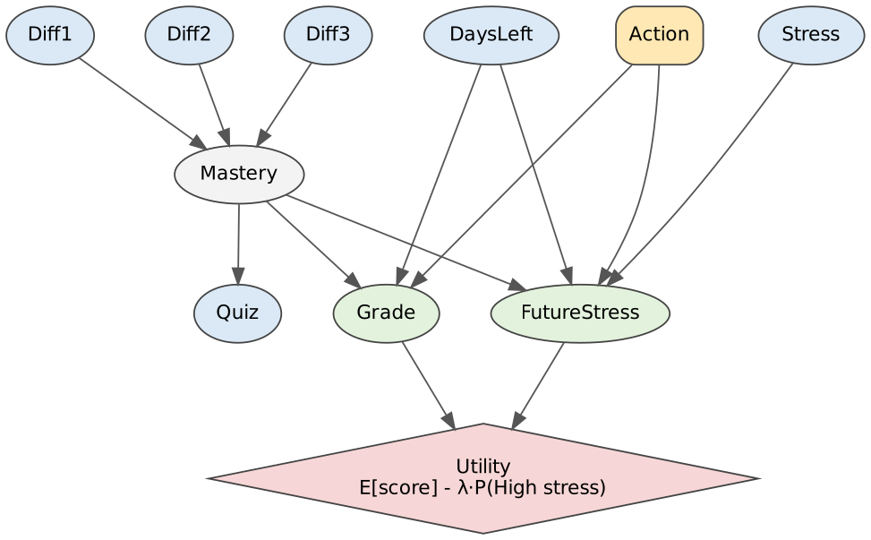

# Bayesian Study Planner

A decision-theoretic study scheduler. Given upcoming exam dates and what it knows about the
student, it uses a Bayesian network to estimate **exam outcome** and **stress** under each possible
action, picks the action with the highest expected utility, and writes it to a calendar.

    evidence --> Bayes net --(exact inference)--> P(Grade), P(Stress) per action
             --> utility = E[score] - lambda * P(High stress) --> best action --> calendar event



Blue = observed evidence, grey = latent, orange = decision, green = queried outcomes.

## The decision

| Action | Calendar effect |
|---|---|
| `Intense5h` | A mandatory 5-hour study block, placed around existing events (split if no single gap fits) |
| `Moderate3h` | A 3-hour study block |
| `Light1h` | A 1-hour review |
| `Rest` | Clears planner blocks for the day and adds a protected all-day rest event |

**Inference task.** With evidence `{Diff1..3, Quiz, DaysLeft, Stress}`, for each action `a` the
planner queries `P(Grade | e, Action=a)` and `P(FutureStress | e, Action=a)` by variable
elimination, scores `U(a) = E[exam score] - lambda * P(FutureStress=High)` (lambda = 30), and takes
the argmax. It re-plans every day, so the schedule adapts as quiz results and stress change.

The ten variables, every CPT parameter and the tuning history are documented in
[`docs/model_parameters.md`](docs/model_parameters.md).

## Quick start

```bash
pip install -e ".[dev]"
study-planner demo                         # four scenarios; writes .ics files to Downloads
pytest
```

Import the `.ics` files into Google Calendar, Apple Calendar or Outlook. Without installing:
`PYTHONPATH=src python -m study_planner demo`.

To make a plan from your own exam and current study signals:

```bash
study-planner plan --exam-date 2026-12-01 \
  --diff1 Hard --diff2 Easy --diff3 Hard --quiz OK --stress Low \
  --exam-name "CS Exam"
```

The start date defaults to today. The planner uses the quiz and stress values as its initial
evidence, then uses the toy simulator to estimate how those signals may change as scheduled
sessions are completed. The command prints each day's expected utility for all four actions.
Generated `.ics` files go to the current user's Downloads folder by default (including redirected
Windows Downloads folders and Linux XDG Downloads settings). Use `--out` to choose another file
path for `plan` or directory for `demo`. If the default Downloads folder cannot be created or
accessed, output falls back to the current working directory.
Use `--calendar google` to write directly to Google Calendar instead; the first run opens Google's
OAuth consent flow and stores a local token at `token.json`. Enable the Google Calendar API and
create an OAuth **Desktop app** client first, saving its file as `credentials.json`. Set
`--calendar-id` and `--timezone` if needed. Google credentials and tokens are ignored by Git.

```python
import datetime as dt
from study_planner import BayesNet, decide

bn = BayesNet()
evidence = dict(Diff1="Hard", Diff2="Easy", Diff3="Hard", Quiz="OK", DaysLeft="Some", Stress="Low")
d = decide(bn, evidence)
print(d.best, d.eu)          # chosen action and expected utility of each option
```

## Results

Captured output is in [`examples/demo_output.txt`](examples/demo_output.txt).

**Concept difficulty alone changes the action** (Some days left, Quiz=OK, Stress=Low):

| Hard concepts | P(Mastery = Low) | Action |
|---|---|---|
| 0 | 0.08 | Moderate3h |
| 1 | 0.14 | Moderate3h |
| 2 | 0.29 | Intense5h |
| 3 | 0.46 | Intense5h |

**Eight-day plans** (I = intense 5h, M = moderate 3h, R = rest):

| Student | Plan | Hours |
|---|---|---|
| Struggling (all hard, Poor quiz) | I I R I R I I R | 25 |
| Advanced (all easy, Good quiz) | R R R R R R M M | 6 |
| Mixed (one hard concept) | M M M R M M M R | 18 |
| Anxious but able | R M R M M M R M | 15 |

## Google Calendar

`study_planner.calendars.google.GoogleCalendar` implements the same `CalendarBackend` interface as
the offline `.ics` backend. Install with `pip install ".[google]"` and create an OAuth Desktop app
client in the Google Cloud console. The `plan --calendar google` command handles local OAuth
authorization; the backend can also be constructed directly with authorized credentials:

```python
from study_planner.calendars.google import GoogleCalendar
cal = GoogleCalendar(creds, calendar_id="primary", tz="America/Vancouver")
plan(student, "CS Exam", exam_date, today, cal, bn)
```

Planner events are tagged (`extendedProperties.private.tag`) so re-planning replaces only its own
events. **Never commit `credentials.json` / `token.json`** (they are in `.gitignore`).

## Layout

```
src/study_planner/
  model.py        variables, CPT parameters
  inference.py    variable elimination (+ brute-force checker)
  decision.py     utility and expected-utility maximisation
  simulation.py   toy student simulator and daily planning loop
  scenarios.py    demo students and snapshots
  cli.py          `study-planner demo`
  calendars/      base (scheduling), ics (offline), google (Calendar API v3)
tests/            model, inference, decision behaviour, calendar, simulation
docs/             network diagram, parameter reference
```

## Limitations

- **Google Calendar has not been tested against a live account.** Its request construction,
  timezone handling, and event conversion are covered by mocked API tests; OAuth setup, permissions,
  quotas, and real-calendar behavior still need a user-account smoke test.
- **The simulator is a toy.** Day-to-day changes in progress and stress are simple rules used to roll
  the demo forward. All decisions come from the Bayes net, but the dynamics are not validated.
- **Parameters are handcrafted and were tuned after inspecting plans** (see the tuning history).
  The results show the model behaves coherently, not that it predicts real outcomes.
- **Decisions are greedy, one day at a time**, re-planned daily, not optimised over whole schedules.
- **Plans can be aggressive**, e.g. consecutive 5-hour blocks, or a week of rest for a strong
  student. A real deployment should cap consecutive intense days and enforce minimum review.
- The three concepts are not scheduled individually: sessions are labelled with the Hard concepts
  (or the first concept if none are Hard), not allocated per concept.
- The default dates for the four-scenario demo are relative to the day it is run. `examples/` files
  are captured sample outputs, not refreshed automatically.

## License

MIT (replace `<YOUR NAME>` in `LICENSE`).
